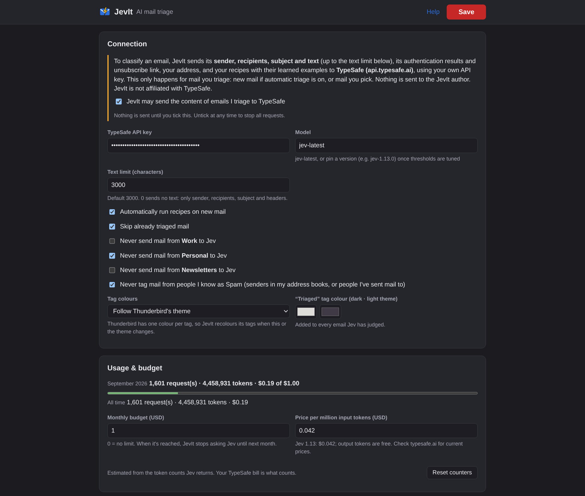
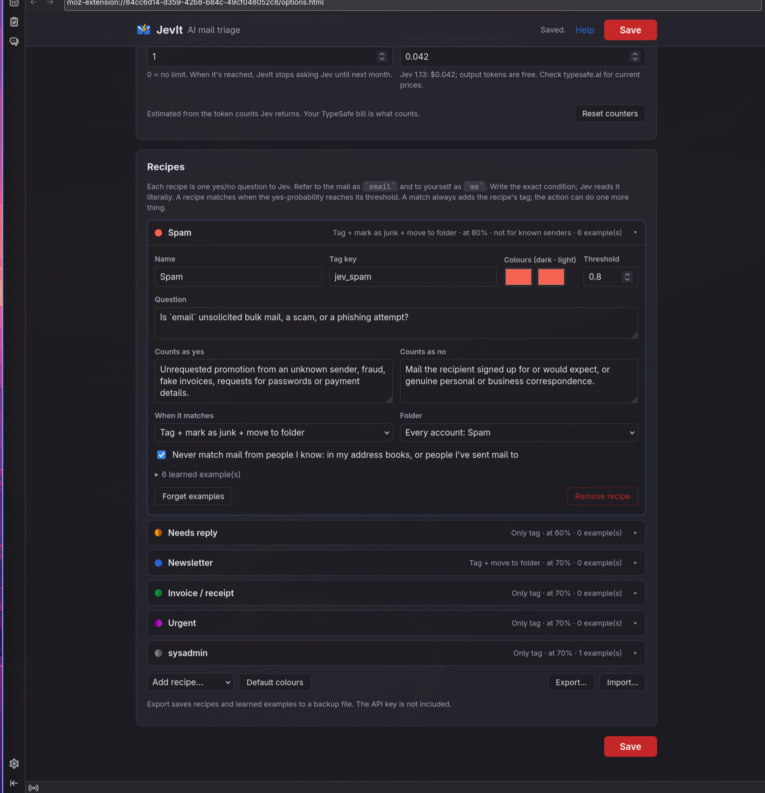

# JevIt: AI mail triage

A Thunderbird add-on that sorts your mail with **recipes**: plain-language yes/no questions ("Is this an invoice or receipt?") that TypeSafe's Jev model answers for each email. When a recipe's answer passes its threshold, JevIt tags the mail and can also star it, mark it read, mark it as junk, or move it to a folder.

Unofficial; not affiliated with TypeSafe.

**Install:** [JevIt on addons.thunderbird.net](https://addons.thunderbird.net/addon/jevit-ai-mail-triage/), or in Thunderbird search for "JevIt" under Add-ons and Themes.

| Connection, usage and budget | Recipes |
|---|---|
|  |  |

## Features

- Ready-made recipes: Spam, Needs reply, Newsletter, Invoice / receipt, Urgent, Meeting / event, Shipping, Security alert, Phishing, Personal, Social, Jobs / recruiting.
- Write your own recipes, or create one from selected mail ("more like this").
- Teach Jev from your corrections: right-click → JevIt → "This is …" / "This is not …". Shortcuts: Alt+Shift+S (spam), Alt+Shift+D (not spam).
- See Jev's scores for the open email in the message-header popup, then correct and apply them.
- Triage selected mail from the context menu, or automatically for new mail. Already triaged mail is skipped by default.
- Progress on the toolbar button while triaging. Click the button to stop a long run. When a manual run is done, one notification sums up what each recipe matched.
- A Triaged tag on every mail Jev has judged (optional), and tag colours for both light and dark themes.
- Careful with uncertain mail: star, mark read, junk and move only happen when Jev is at least 90% sure. Below that, and for near misses, mail gets an Unsure tag to review and teach Jev from.
- Move matches to one folder, or to a folder of the same name in each account (such as each account's own Junk).
- Jev sees where links really go (the host name behind each link text), which helps the Spam and Phishing recipes. Links are never opened.
- Mail from your contacts, or from people you've written to, is never tagged as Spam, when your mail server's DMARC check confirms the sender. This is checked locally.
- Exclude accounts: mail in them is never sent to Jev.
- Jev's scores are remembered locally: the header popup, and triaging mail again after changing a threshold, cost nothing. Only edited or taught recipes are asked again.
- Usage and a monthly budget (default $1) so costs stay in check.
- Export and import recipes as a JSON backup.

## How it works

A Thunderbird 128+ MailExtension (Manifest V2) in plain JavaScript: no build step, no dependencies.

| File | Role |
|---|---|
| `jev.js` | Shared logic: recipe library, request building, Jev client, scoring, usage and budget, sender checks, tags |
| `background.js` | Triage runs (4 mails in parallel), context menus, auto-triage of new mail, toolbar progress, update migration |
| `options.*` | The JevIt manager: connection, budget, recipes, backup export and import |
| `popup.*` | Jev's scores for the open email, to correct and apply |
| `test.js` | Node logic tests with stubbed `messenger` and `fetch`; a live check against Jev with `TYPESAFE_API_KEY` |

**Classification.** Each email is one request to `api.typesafe.ai/v1/systemone` with one JSON state:
sender, To/Cc, subject, the cleaned body (3000 characters by default), the Authentication-Results, List-Unsubscribe and Reply-To headers,
link text next to the host it really points to, attachment names and types, and your own address.
Every recipe is a TypeSafe **Noul** (a yes/no probability) with yes/no criteria and up to 20 learned examples, all in the same request.
A recipe matches at its threshold. Star, read, junk and move wait until Jev is at least 90% sure; near misses get the Unsure tag.
Rate limits (429/529) are retried with exponential backoff.

**Safety and cost.**
- Every field the sender controls is capped (1000 characters per header, 20 recipients, 10 links, 10 attachments), so a sender can't inflate the request.
- A sender only counts as known after a DMARC pass for the From domain, in the Authentication-Results header written by your own mail server (learned from recent Inbox mail). The address book and Sent-folder lookup is local.
- Jev's scores are stored for 90 days, keyed by a SHA-256 of the email and of each question: triaging again and the popup are free, and only edited or taught recipes are asked again.
- Usage is counted as input tokens × price against a monthly budget ($1 by default). Nothing is sent before you opt in, and whole accounts can be excluded.

Everything (API key, recipes, examples, usage, scores) stays in Thunderbird's `storage.local`. There is no server, telemetry or analytics.

## Requirements

- Thunderbird 128 or newer
- A TypeSafe API key from https://typesafe.ai (usage is billed by TypeSafe)

Nothing is sent until you allow it in the JevIt manager. Mail content goes only to TypeSafe. See the privacy policy in [LISTING.md](LISTING.md).

## Development

There's no build step. To try it, go to Add-ons → gear → Debug Add-ons → Load Temporary Add-on and pick `manifest.json`.

```sh
node test.js      # logic tests; set TYPESAFE_API_KEY to also run the default recipes against Jev
zip jevit.xpi manifest.json LICENSE icon-*.png jev.js background.js popup.* options.* help.html style.css
```

## Support

JevIt is free. If it saves you time, you can buy me a coffee at [ko-fi.com/jevit](https://ko-fi.com/jevit).

## License

[MPL-2.0](LICENSE)

## Review record

[AUDIT.md](AUDIT.md) is a record of an outside review of one commit: what that commit sends, which exposures were filed, and a reading of the license. To add a finding or dispute one, open an issue, or a pull request that changes AUDIT.md, and name the commit and the file you read.
